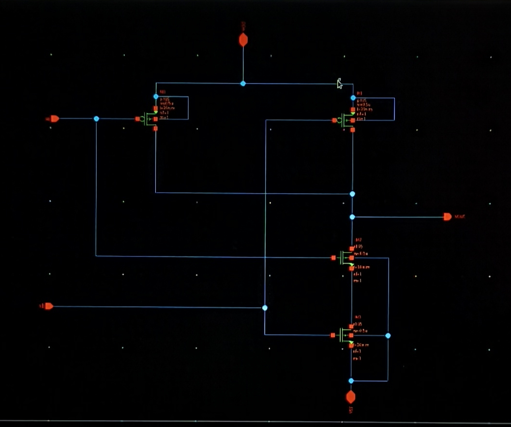
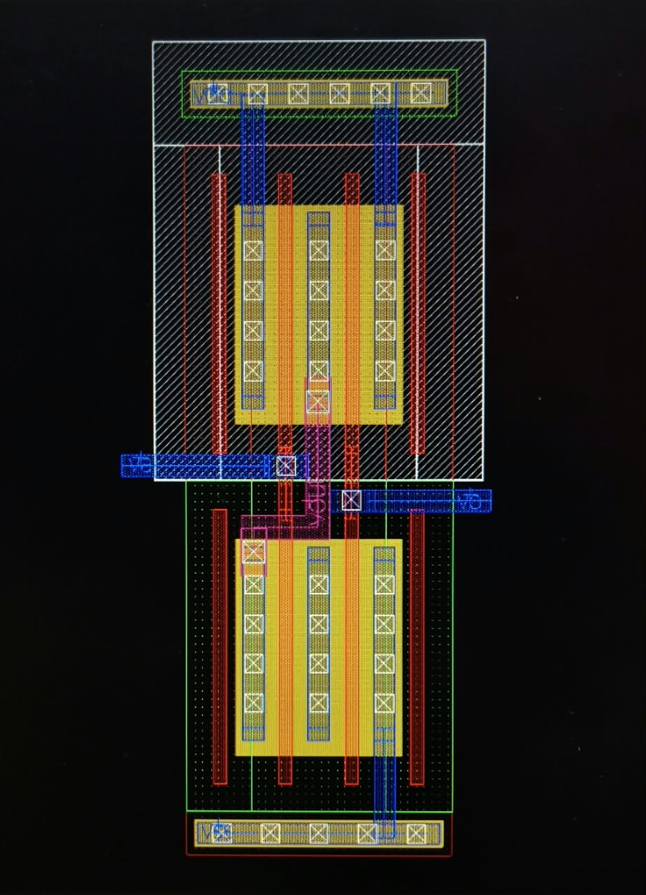
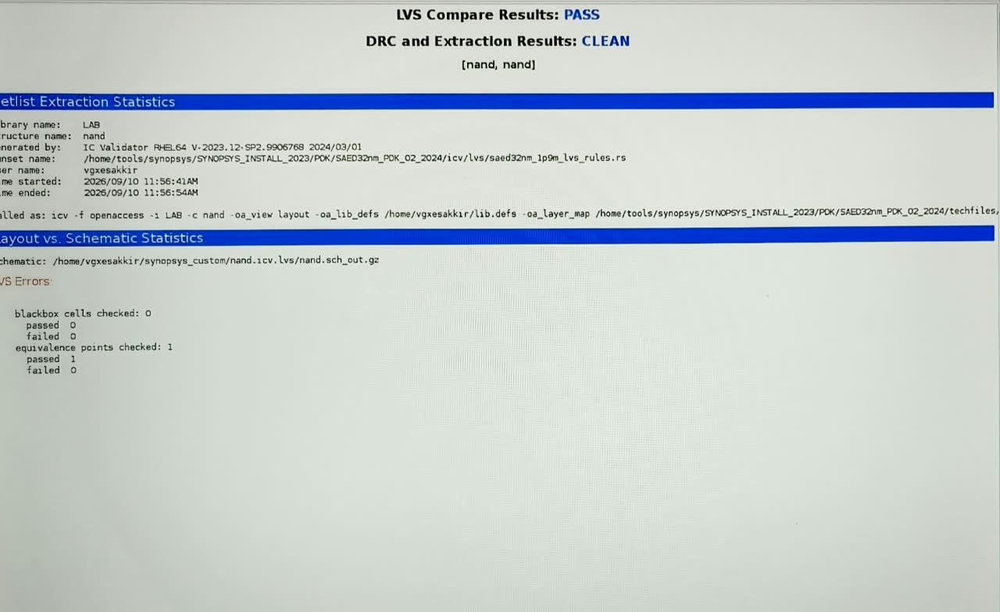
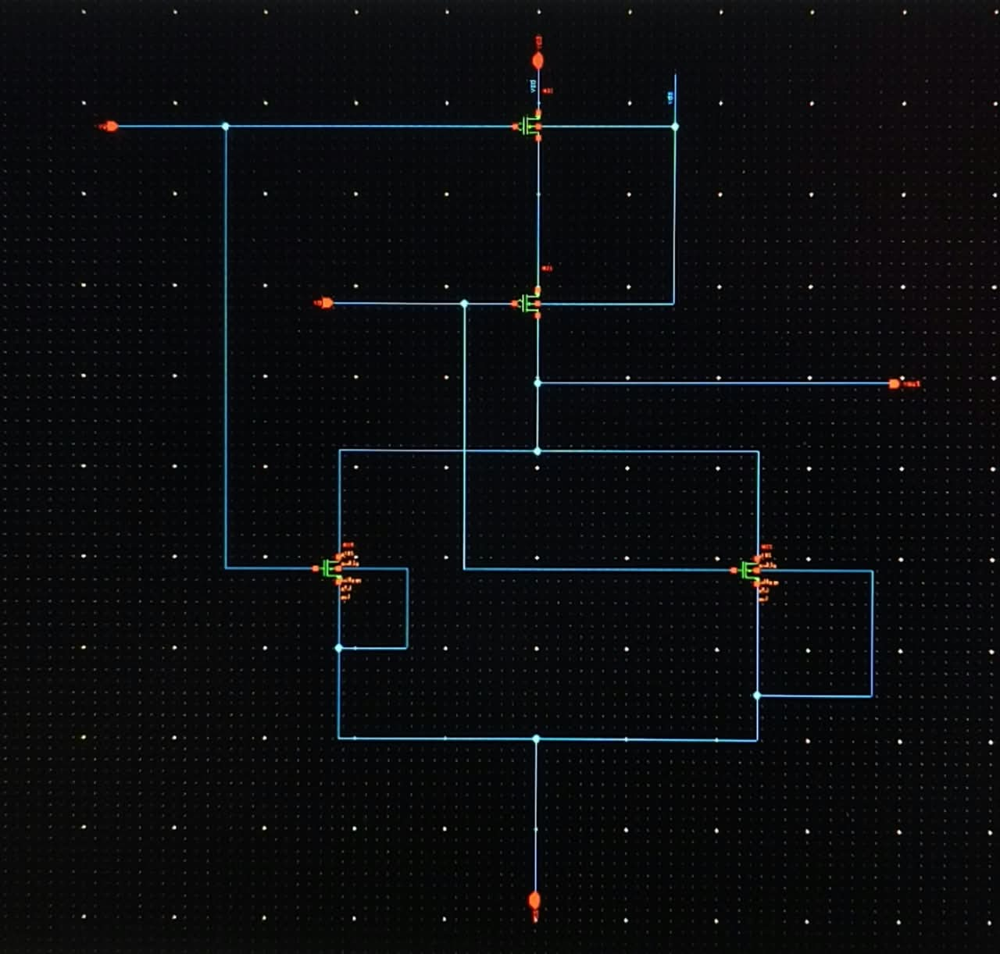
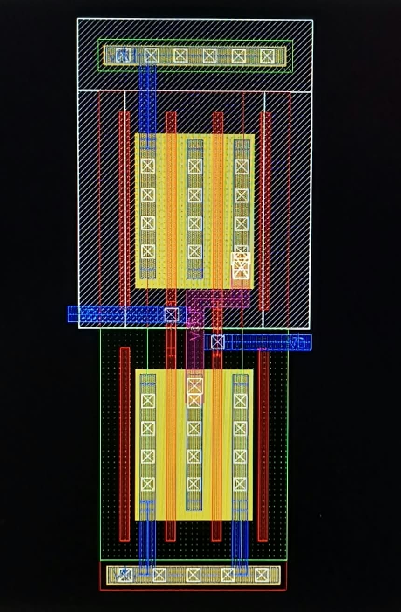
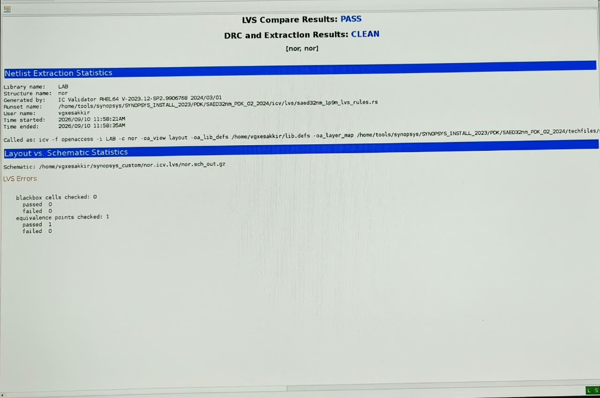

# CMOS NAND and NOR Gate Layout Design Using Synopsys Custom Compiler

## Project Overview

This project demonstrates the complete custom VLSI design flow for **2-input CMOS NAND** and **2-input CMOS NOR** gates using **Synopsys Custom Compiler** and the **SAED 32nm technology library**.

The design flow includes:

- Schematic design
- Transistor-level implementation
- Physical layout creation
- Design Rule Check (DRC)
- Layout Versus Schematic (LVS) verification
- Parasitic extraction validation

Both NAND and NOR cells were successfully verified with:

- ✅ DRC Clean
- ✅ LVS Pass
- ✅ Correct netlist extraction

---

## Technology Used

| Parameter | Value |
|------------|---------|
| Technology Node | SAED 32nm |
| Tool | Synopsys Custom Compiler |
| Verification Tool | IC Validator (ICV) |
| Design Style | CMOS |
| Gate Types | NAND, NOR |

---

# 1. CMOS NAND Gate

## NAND Truth Table

| A | B | Y = NAND(A,B) |
|---|---|---|
| 0 | 0 | 1 |
| 0 | 1 | 1 |
| 1 | 0 | 1 |
| 1 | 1 | 0 |

---

## NAND Schematic

The NAND gate is implemented using:

### Pull-Up Network (PUN)
- Two PMOS transistors connected in **parallel**

### Pull-Down Network (PDN)
- Two NMOS transistors connected in **series**

This arrangement ensures that the output becomes LOW only when both inputs are HIGH.



---

## NAND Layout

Layout implementation was created following SAED32nm design rules.

### Layout Features

- PMOS devices placed inside N-well
- NMOS devices placed inside P-substrate
- Shared diffusion used for area optimization
- Metal routing for input/output connectivity
- Proper VDD and GND rails



---

## NAND Verification Results

### DRC Results
- No design rule violations detected

### LVS Results
- Layout matches schematic successfully

### Extraction Status
- Clean netlist extraction

**Result:** PASS



---

# 2. CMOS NOR Gate

## NOR Truth Table

| A | B | Y = NOR(A,B) |
|---|---|---|
| 0 | 0 | 1 |
| 0 | 1 | 0 |
| 1 | 0 | 0 |
| 1 | 1 | 0 |

---

## NOR Schematic

The NOR gate is implemented using:

### Pull-Up Network (PUN)
- Two PMOS transistors connected in **series**

### Pull-Down Network (PDN)
- Two NMOS transistors connected in **parallel**

This configuration produces a HIGH output only when both inputs are LOW.



---

## NOR Layout

The physical layout follows standard CMOS design methodology and SAED32nm design constraints.

### Layout Features

- PMOS transistors placed in N-well region
- NMOS transistors placed in substrate region
- Optimized routing using Metal layers
- Shared contacts and diffusion regions
- Compact cell implementation



---

## NOR Verification Results

### DRC Results
- No design rule violations found

### LVS Results
- Layout and schematic matched successfully

### Extraction Status
- Clean extraction report generated

**Result:** PASS



---

# Design Flow

```text
Specification
      ↓
Schematic Design
      ↓
Simulation
      ↓
Layout Design
      ↓
DRC Check
      ↓
LVS Verification
      ↓
Parasitic Extraction
      ↓
Final Verified Cell
```

---

# Results Summary

| Design | DRC | LVS | Extraction |
|----------|------|------|------------|
| NAND Gate | PASS | PASS | CLEAN |
| NOR Gate | PASS | PASS | CLEAN |

---

# Learning Outcomes

Through this project:

- Designed CMOS NAND and NOR gates at transistor level.
- Created custom layouts using Synopsys Custom Compiler.
- Applied SAED32nm design rules.
- Performed DRC verification.
- Performed LVS verification.
- Validated extracted netlists.
- Understood the complete custom IC design flow.

---

# References

1. Synopsys Custom Compiler User Guide
2. SAED 32nm PDK Documentation
3. CMOS VLSI Design – Neil H. E. Weste and David Harris
4. IC Validator (ICV) Verification Documentation

---

## Author

**Esakkiraj G**
B.E. Electronics and Communication Engineering
Custom & Analog Layout Trainee

**Domain:** VLSI | Custom Layout | Analog Layout | CMOS Design
